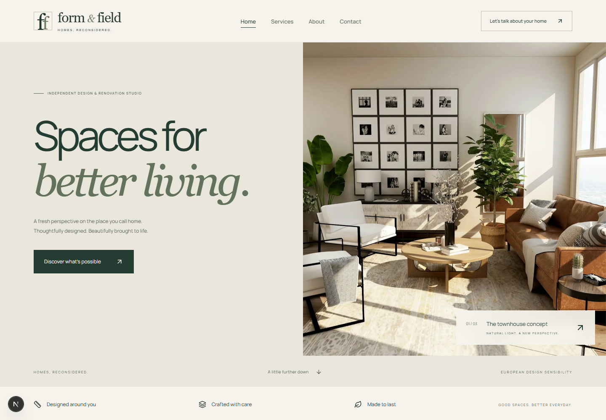

# Form & Field

**Live demo:** [form0-and-field.netlify.app](https://form0-and-field.netlify.app/)

A complete four-page portfolio demo for a fictional premium European renovation studio. Built with Next.js App Router, React, TypeScript and Tailwind CSS v4. Original branding; no fabricated clients, reviews, awards or completed-project claims.



## Run locally

Requires Node.js 20.9+ and npm. Tested with Node.js 24.

```sh
npm install
npm run dev
```

Open http://localhost:3000. On Windows, use `npm.cmd` if PowerShell blocks npm.ps1. If your managed environment uses an enterprise certificate authority, enable Node's system certificates with `NODE_USE_SYSTEM_CA=1`. A workspace-local npm cache can be selected with `npm install --cache .npm-cache`.

## Production and checks

```sh
npm run build
npm run typecheck
npm run start
```

Build once before the browser suite:

```sh
npm run test:e2e
```

The suite uses an installed Google Chrome browser (`channel: 'chrome'`) and covers desktop and mobile pages, image loading, horizontal overflow, navigation, keyboard comparison controls, project tabs, FAQs, invalid form submissions and successful demo confirmation without POST requests. If Chrome is unavailable, install Chromium with `npx playwright install chromium` and remove `channel: 'chrome'` from `playwright.config.ts`. The test runner owns and stops its production server on isolated port 3107, leaving any existing application on port 3000 alone.

See [VALIDATION.md](VALIDATION.md) for the completed checks. Desktop and mobile screenshots are included in `docs/screenshots/`. Source formatting is available with `npm run format`.

## Pages and interactions

### Languages

The header includes English, Deutsch, Nederlands and Türkçe on desktop and mobile. All four pages are translated, including navigation, services, FAQs, concept project copy, image descriptions, contact validation, demo confirmation and SEO titles/descriptions. English remains available at the original URLs; translated pages use `/de`, `/nl` and `/tr`, followed by `/services`, `/about` or `/contact`. The language selector keeps the current page, query parameters and fragment. Refreshing a translated URL retains the language; no language cookie or external translation service is used.

All 16 language/page combinations are prerendered. Each includes its correct HTML language, canonical URL, alternate language links and Open Graph locale. The sitemap lists each language version. English `/en` routes are also supported, with canonical links to the original unprefixed URLs. Invalid language prefixes return 404.

Translation source is `src/lib/translations.ts`: each row contains English, German, Dutch and Turkish. Run `npm run check:translations` to verify every row is complete and static translation calls reference existing entries. Form field values use language-independent identifiers so switching language does not change the selected service or budget. The multilingual browser suite checks routing, metadata, form flows, back navigation and narrow 320px layouts in addition to the original tests.

- `/`: photographic hero, service cards, three-project comparison gallery, process, FAQ and enquiry CTA.
- `/services`: detailed scopes with links that preselect the contact form service.
- `/about`: studio philosophy and explicitly fictional brand context.
- `/contact`: required field validation, inline accessible errors, error focus, optional euro budget, demo acknowledgement, confirmation and reset.

The form is intentionally client-only. It makes no submission request, uses no persistent storage and books no consultation. Navigation and page content work without JavaScript; form and gallery interactions require JavaScript. Before/after images are different stock interiors, clearly labelled as concept inspiration rather than real transformations.

## SEO and accessibility

Each page has its own title, description, canonical, Open Graph and Twitter metadata. `/opengraph-image` generates a branded 1200 × 630 PNG without external font requests. `/sitemap.xml`, `/robots.txt` and an original SVG favicon are included.

Copy `.env.example` to `.env.local` and set `NEXT_PUBLIC_SITE_URL` to your real origin before deploying. The placeholder is a reserved `.example` domain. The demo intentionally sets `noindex, follow` in root metadata so fictional commercial content is not indexed; remove `index: false` for a real, verified business launch. The crawler remains able to read the noindex directive.

Includes semantic landmarks, a skip link, current-page navigation, labelled form controls, error descriptions, keyboard-operable tabs and range input, native FAQ disclosure controls, visible focus styles and reduced-motion support. No analytics, cookies, third-party runtime scripts or remote fonts. Uses server components by default; only navigation, comparison controls and form are client components. Local photographs use Next Image responsive sizing, lazy loading and optimisation; lead photography is prioritised. Automated checks are not a full manual accessibility audit.

## Assets, inspiration and design handoff

See [ASSETS.md](ASSETS.md) for stock image sources and licence information and [DESIGN.md](DESIGN.md) for tokens, layouts, responsive rules and a Figma reconstruction brief. Photographs are stored locally in `public/images` and require no external host during browsing. `lucide-react` provides ISC-licensed icons. System serif and sans-serif font stacks are paired with locally hosted Manrope for navigation; no runtime external font service is required.

[Godly.design](https://godly.design/) was consulted for general editorial website inspiration. No third-party site layout, branding or source code was copied. Figma tooling was not connected in the development environment; no Figma file is claimed. The included design handoff records the implemented design for a future Figma file.

## Deployment

This is a standard Node-hosted Next.js project. Install with `npm ci`, build with `npm run build`, serve with `npm run start`, and supply `NEXT_PUBLIC_SITE_URL` at build time. Commit the generated package-lock.json. No secrets, database or API credentials are needed. Before adapting for a real company, replace illustrative imagery and business content, confirm licences and contact handling, add appropriate privacy information, and connect a secure server-side submission endpoint. The live demo is hosted on Netlify at https://form0-and-field.netlify.app/.
